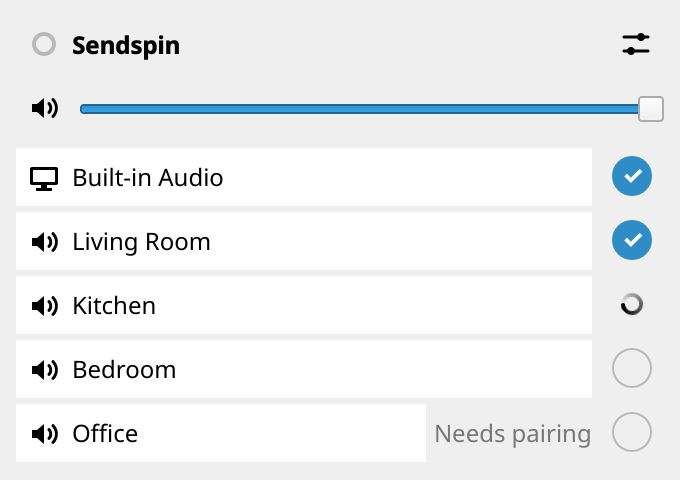

<p align="center">
  
</p>

<h1 align="center">Sendspin for Linux</h1>

<p align="center">Your PC's sound on every speaker: lossless, in sync and open source, using <a href="https://www.sendspin-audio.com/">Sendspin</a>.</p>

<p align="center">
  <a href="https://github.com/Sendspin/sendspin-for-linux/releases"></a>
</p>

Play this PC's sound on your Sendspin speakers: wireless, lossless and in sync. Sendspin for
Linux adds an output named **Sendspin** to your sound
settings and a small tray app to pick the speakers it plays on. If you run Music Assistant, it
can play to this PC too, and take this PC's sound as an input for anything it controls.

[](https://www.openhomefoundation.org/)



## Install

The packages come from a signed repository, so the system's updates bring new versions. Three
steps: get the repository's key, check it, then add the repository and install.

### Debian 13 and Ubuntu 26.04

1. Download the key:

   <!-- repo-setup: apt -->
   ```sh
   sudo wget -O /etc/apt/keyrings/sendspin.asc https://sendspin.github.io/sendspin-for-linux/sendspin.asc
   ```

2. Check that it is ours, before anything is installed with it:

   ```sh
   gpg --show-keys /etc/apt/keyrings/sendspin.asc
   ```

   It should print this fingerprint. If it doesn't, stop here.

   ```
   85FF 9044 844F D44C 8BE6  98B9 C117 75C2 E4CA 1288
   ```

3. Add the repository and install:

   <!-- repo-setup: apt -->
   ```sh
   . /etc/os-release && echo "deb [signed-by=/etc/apt/keyrings/sendspin.asc] https://sendspin.github.io/sendspin-for-linux/apt $ID$VERSION_ID main" | sudo tee /etc/apt/sources.list.d/sendspin.list
   sudo apt update
   sudo apt install sendspin-for-linux
   ```

   On a distribution built on one of them, write `debian13` or `ubuntu26.04` in place of
   `$ID$VERSION_ID`.

### Fedora 44 and 45

1. Download the key:

   <!-- repo-setup: dnf -->
   ```sh
   sudo curl -fsSLo /etc/pki/rpm-gpg/RPM-GPG-KEY-sendspin https://sendspin.github.io/sendspin-for-linux/sendspin.asc
   ```

2. Check that it is ours, before anything is installed with it:

   ```sh
   gpg --show-keys /etc/pki/rpm-gpg/RPM-GPG-KEY-sendspin
   ```

   It should print this fingerprint. If it doesn't, stop here.

   ```
   85FF 9044 844F D44C 8BE6  98B9 C117 75C2 E4CA 1288
   ```

3. Add the repository and install:

   <!-- repo-setup: dnf -->
   ```sh
   sudo curl -fsSLo /etc/yum.repos.d/sendspin.repo https://sendspin.github.io/sendspin-for-linux/rpm/sendspin.repo
   sudo dnf install sendspin-for-linux
   ```

That's it: Sendspin is in your launcher, starts with your session from now on, and new versions
arrive with the system's updates. From here on your system takes nothing that key did not sign.

### Arch Linux

Not in the AUR yet. Until it is, download the `.pkg.tar.zst` from
[Releases](https://github.com/Sendspin/sendspin-for-linux/releases) and install it:

```sh
sudo pacman -U ./sendspin-for-linux-*-archlinux-x86_64.pkg.tar.zst
```

A new version is a new download.

### Flatpak

Coming soon to Flathub. Until then, each release carries a bundle, which installs with its
runtime from Flathub:

```sh
flatpak install --user ./sendspin-for-linux-*-x86_64.flatpak
```

The Flatpak doesn't start with your session until you switch on **Open at login** in Settings.

### A package from Releases

If you'd rather not add a repository, download the `.deb` or `.rpm` for your system from
[Releases](https://github.com/Sendspin/sendspin-for-linux/releases), where `SHA256SUMS` has
each file's checksum:

```sh
sudo apt install ./sendspin-for-linux-*-debian13-amd64.deb     # Debian 13
sudo apt install ./sendspin-for-linux-*-ubuntu26.04-amd64.deb  # Ubuntu 26.04
sudo dnf install ./sendspin-for-linux-*-fedora44-x86_64.rpm    # Fedora 44
sudo dnf install ./sendspin-for-linux-*-fedora45-x86_64.rpm    # Fedora 45
```

Installed this way, Sendspin updates itself: see [Updates](#updates).

## What you need

- **Fedora 44, Ubuntu 26.04 or Debian 13**, or newer, or **Arch Linux**. Ubuntu 24.04 and
  Debian 12 are too old.
- **PipeWire** for sound, which all of them use by default.
- **Speakers or players that speak Sendspin.** Sendspin's site keeps
  [the current list](https://www.sendspin-audio.com/#speakers).

Music Assistant is optional: without it, this PC plays to the speakers on its own.

## Using it

### Pick your speakers

Click the tray icon to open the picker. On a desktop without a tray, such as stock GNOME, start
Sendspin again from the launcher instead.

- **Tick a speaker** and the PC's sound plays on it. Ticking the first one makes **Sendspin**
  your system's output; unticking the last one puts back the output you had.
- **The slider** on the Sendspin row is the volume of all the ticked speakers together.
- **This PC's own output** is the first row. Tick it next to a speaker and it plays along, in
  sync with the others. On its own, the PC plays as it always did.

A speaker that needs pairing asks for its code when you tick it. Settings lists the speakers
you've paired, each with **Forget**.

### With Music Assistant

Music Assistant finds this PC on the network by itself. It then shows up in the picker, below
the speakers.

- **Music Assistant plays here.** This PC is a player in Music Assistant like any other, with no
  setup. What it plays shows in your desktop's media controls.
- **This PC as an input.** Pair first: set this PC up in Music Assistant and enter the code that
  pops up here, in a notification and in the picker. Then choose Music Assistant in the picker
  and select this PC as an input source there. Music Assistant now plays the PC's sound on any
  of its speakers and groups, and chooses the speakers and the volume.

With **Allow playback without pairing** on, as it is by default, any Sendspin server on the
network this PC is connected to can play to it: on a laptop that joins networks you don't trust,
switch it off in Settings, under Music Assistant. Using this PC's sound as an input always needs
pairing.

The PC's sound goes to the speakers you ticked or to Music Assistant, one or the other: the two
aren't in sync with each other.

### Settings

**Settings…** in the tray menu, or the gear in the picker. Every change applies at once, except
the device name, which servers see from the next start.

- **This PC:** the name servers see, the output to play on, **Open at login** and
  **Check for updates**.
- **Speakers:** pair one, or forget one.
- **Music Assistant:** the servers this PC is paired with, whether a server may play here
  without pairing, and whether what it plays shows in the desktop's media controls.

**Open at login** starts Sendspin in the tray, without the picker. The packages switch it on for
you; the Flatpak leaves it off.

The settings are kept in `~/.config/sendspin/sendspin.conf`:

```ini
[client]
; what servers call this PC, instead of its hostname
name=Den PC
; false makes a server pair before it may play here
unpaired_access=true

[player]
; the PipeWire node.name to play on, instead of the default output
output=alsa_output.usb-Example_DAC-00.analog-stereo

[mpris]
; false keeps what a server plays here out of the desktop's media controls
enabled=true

[discord]
; true shows what a server plays here in Discord, as "Listening to": the title, artist and album
rich_presence=false

[updates]
; false never asks GitHub for a newer release
check=true
```

Keys, pairings and the speakers you ticked are in `~/.local/share/sendspin/`, readable only by
you.

### Updates

Once a day Sendspin asks GitHub whether there is a newer release, and says so in Settings and in
the tray menu. It sends nothing but the request, and **Check for updates** in Settings turns it
off.

- **From the repository, or the Flatpak:** the system's updates bring the new version. Sendspin
  only tells you of it.
- **From a downloaded `.deb` or `.rpm`:** **Install update** in Settings downloads the new
  package, verifies it, asks for an administrator's password, installs it and restarts Sendspin.
  `sendspin-for-linux --update` does the same from a terminal. The download is verified against
  the key that came with the package you installed,
  `/usr/share/sendspin-for-linux/sendspin.asc`, the one with the fingerprint above; Sendspin
  never fetches a key.
- **On Arch:** a new download, for now.

## Troubleshooting

### No speakers show up

- **Is the speaker a Sendspin speaker, and on the same network?** See
  [the list](https://www.sendspin-audio.com/#speakers). Guest networks and some mesh setups keep
  devices from finding each other.
- **Does the picker say discovery is unavailable?** Speakers are found over mDNS, which needs
  Avahi running:

  ```sh
  sudo systemctl enable --now avahi-daemon
  ```

- **Is a firewall in the way?** Sendspin needs mDNS (UDP 5353) to find speakers and be found,
  TCP 8927 for speakers that connect to this PC, and TCP 8928 for Music Assistant. Fedora
  Workstation's default firewall and Ubuntu's (off by default) let all of it through. If yours
  is stricter:

  ```sh
  # firewalld (Fedora)
  sudo firewall-cmd --permanent --add-service=mdns --add-port=8927-8928/tcp
  sudo firewall-cmd --reload

  # ufw (Ubuntu, Debian)
  sudo ufw allow 5353/udp
  sudo ufw allow 8927:8928/tcp
  ```

### A speaker is ticked, but silent

- **Check the output.** Your sound settings should show **Sendspin** as the output while a
  speaker is ticked. An app that was sent to another output by hand stays there.
- **Check both volumes.** The picker's slider is the speakers' volume; the desktop's volume
  control sets the level of what is sent to them. Either one at zero is silence.
- **This PC's output says "Can't play".** Its delay is longer than the speakers' buffer, as
  Bluetooth's can be, so it can't play along in sync.

### Music Assistant doesn't see this PC, or pairing fails

- Both need to be on the same network, with the firewall as above: Music Assistant connects to
  this PC, on TCP 8928.
- The code is only valid while it shows. If it's gone, start pairing again in Music Assistant.
- Music Assistant plays here but can't use the PC as an input: an input needs pairing, playing
  doesn't.

### Getting logs

Sendspin logs little while it works: its start, what it plays on, a server or a speaker coming
and going, and anything that went wrong. To see what it logged since you logged in:

```sh
journalctl --user -b /usr/bin/sendspin-for-linux
```

For a bug report, quit Sendspin from the tray menu and start it from a terminal with `--verbose`
(or `-v`), which adds every dial, connection and timing line:

```sh
sendspin-for-linux --verbose 2> sendspin.log
# the Flatpak
flatpak run com.sendspin_audio.Sendspin --verbose 2> sendspin.log
```

Reproduce the problem, then attach `sendspin.log`. No key or pairing code is logged at any
level.

### Still stuck?

Open an [issue](https://github.com/Sendspin/sendspin-for-linux/issues) with your distribution
and desktop, how you installed Sendspin, the output of `sendspin-for-linux --version`, and the
logs.

## Uninstall

```sh
# Debian and Ubuntu
sudo apt remove sendspin-for-linux
sudo rm -f /etc/apt/sources.list.d/sendspin.list /etc/apt/keyrings/sendspin.asc

# Fedora
sudo dnf remove sendspin-for-linux
sudo rm -f /etc/yum.repos.d/sendspin.repo /etc/pki/rpm-gpg/RPM-GPG-KEY-sendspin

# Arch Linux
sudo pacman -R sendspin-for-linux

# Flatpak
flatpak uninstall com.sendspin_audio.Sendspin
```

To remove your settings and pairings as well:

```sh
rm -rf ~/.config/sendspin ~/.local/share/sendspin ~/.config/autostart/com.sendspin_audio.Sendspin.desktop
```

## Developing

Building it, or working on it? See [docs/DEVELOPING.md](docs/DEVELOPING.md).

## License

[Apache 2.0](LICENSE)
